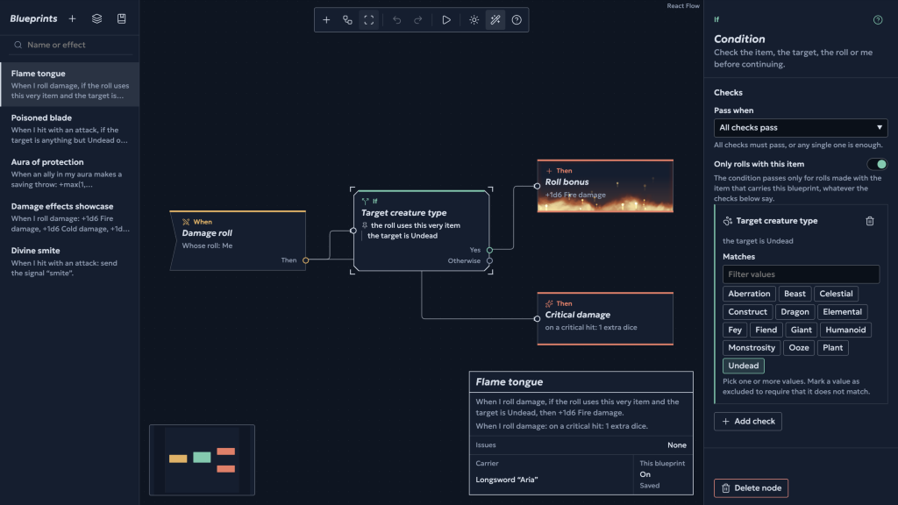
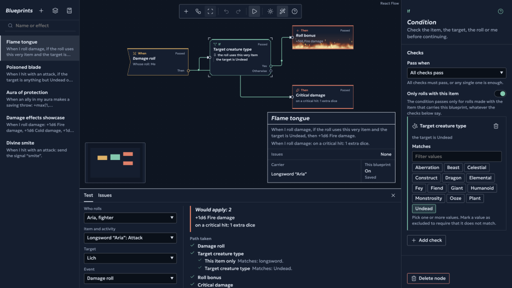
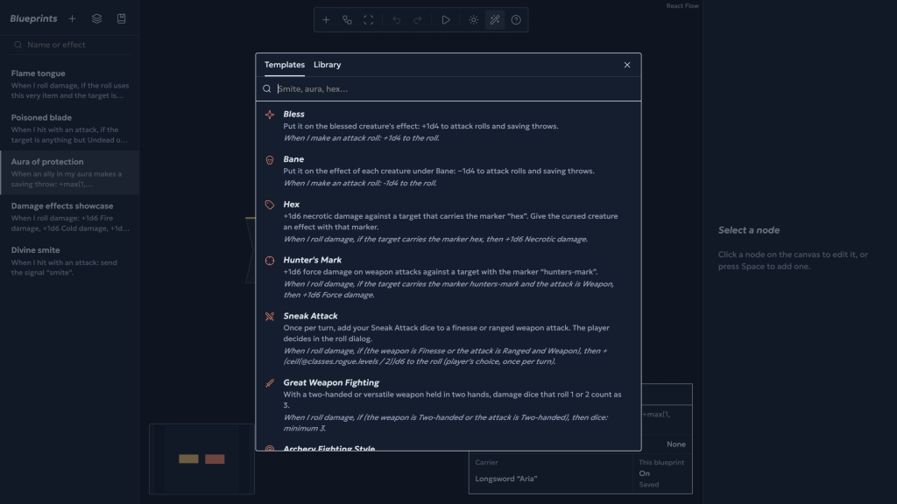

<div align="center">

**English** · [Русский](README.ru.md)

# Build-n-Action

**Visual `When → If → Then` blueprint automation for D&D 5e in Foundry VTT**

Build node graphs that modify rolls before they happen (bonuses, advantage/disadvantage, expanded crit range, higher save DC) and react to outcomes (prone on hit, heal on drop, demanded saves, counters, or bonuses to the next roll).

[](https://github.com/TacticalOtaku/Build-n-Action/releases/latest)
[](https://github.com/TacticalOtaku/Build-n-Action/actions/workflows/ci.yml)
[](https://foundryvtt.com/)
[](https://github.com/foundryvtt/dnd5e)
[](src/lang/)
[](LICENSE)

[Installation](#installation) · [Screenshots](#screenshots) · [Quick Start](#quick-start) · [How Blueprints Work](#how-blueprints-work) · [Settings](#settings) · [API & Hooks](#api--hooks) · [Development](#development)

</div>

---

## Installation

In Foundry VTT (**Setup → Add-on Modules → Install Module**), paste the **Manifest URL**:

```text
https://github.com/TacticalOtaku/Build-n-Action/releases/latest/download/module.json
```

**Requirements:** Foundry VTT **14.367+** (maximum `14`), D&D 5e **`5.3.3+`**. Optional integrations: **Midi QOL** (`14.0.12+`) and **DAE** (`14.0.14+`).  
**Manual install:** Download `build-n-action-v<version>.zip` from [GitHub Releases](https://github.com/TacticalOtaku/Build-n-Action/releases/latest) and extract it into `Data/modules/build-n-action`.

> [!NOTE]
> Everything works with plain `dnd5e` rolls. With **Midi QOL**, reactions follow its workflows; with **DAE**, blueprints on Active Effects follow its disable conditions and special durations.

---

## Screenshots





---

## Quick Start

1. **Open the editor:** Open an actor, item, effect, or region sheet and choose **Build-n-Action** in its header menu (its icon lights up while a blueprint on the document works). Enabling _Show the Build-n-Action button in the title bar_ adds a title-bar shortcut.
2. **Create a blueprint:** Choose **From a template** for one of the 14 D&D 5e presets, or **New blueprint** for an empty graph.
3. **Build the chain:** Press **Space** on the canvas to add a node and drag from a pin to wire it — an event (**When**) leads through optional conditions (**If**) to results (**Then**), while the title block reads the chain back as a sentence.
4. **Try it:** Press **▶ Test** to simulate the blueprint on an actor, item, and target without rolling. The Test tab shows which step passed or stopped and why.

---

## How Blueprints Work

### Where Blueprints Live

| Carrier                  | Works for                                                                                                                 |
| ------------------------ | ------------------------------------------------------------------------------------------------------------------------- |
| **Actor**                | That actor's rolls                                                                                                        |
| **Item**                 | Its owner's rolls while equipped; tick _Only rolls with this item_ on a condition to limit it to rolls made with the item |
| **Active Effect**        | Its actor's rolls while the effect is active                                                                              |
| **Region**               | Creatures in the region                                                                                                   |
| **Region (enter/leave)** | The creature that entered or left                                                                                         |

The event's _reach_ also lets a blueprint act on others:

- **Aura:** creatures within a range, optionally blocked by walls;
- **Template:** creatures inside your measured templates.

### Effects and DAE

A blueprint on an Active Effect works exactly while the effect is active. Anything that toggles the effect toggles the blueprint:

- DAE's _disable condition_ (e.g. `@attributes.hp.value <= 0`);
- special durations such as _0 HP_;
- equipping the item that carries the effect.

In the editor, the title block shows the effect's state and its DAE rules. **More → Move to a new effect** moves a blueprint from an actor or item onto a new effect.

Conditions offer **My effects** and **Target effects** alongside standard status checks, supporting custom Active Effects: match a full name (case-insensitive) or choose an effect source (drop an Active Effect or enter its UUID), and set **Presence** to **Present** or **Absent**. Only active effects count by default; **Include inactive effects** also counts disabled and suppressed applicable effects (including transferred item effects). Target checks require a target; source matching requires a retained source link (preserved by **Apply effect**), while older or third-party copies should use name matching.

### Combat, Turns, Regions, and Rests

Blueprints can start without a roll: at **combat start**, at the **start or end of a turn** in combat, when a token **enters or leaves a region**, or after a **short or long rest**. They run on the GM's side, once each, and use results that do not modify a roll: effects, resources, reminders (with configurable audience filters: roll dialog, owner, GM, target's owner, or public chat), a bonus to a later roll, or a signal. Region events work on blueprints stored on the region; the module registers its `blueprints` region behavior automatically.

### "And then"

Every result has an **"And then"** switch in its settings. Enabling it adds an output pin to chain follow-up conditions and results that execute only after the result actually applied:

- a mandatory result, when the roll proceeds;
- a player's choice, when the player applied it (and paid its cost) and the roll proceeded;
- a limited result, only while its limit allows;
- never when vetoed via `build-n-action.preApplyResult`.

After **"And then"** come non-roll-modifying results: apply or remove an effect, resources, a bonus to the next roll, a signal, or a reminder. They receive the same roll, item, and target as the preceding result; optional results apply immediately and reminders whisper to owners and the GM.

### Demanded Saves

**"Demand a saving throw"** makes the target, you, or creatures in your aura roll a save against a DC (fixed number, formula, or your spell save DC). Its **Succeeded** and **Failed** outputs continue the chain once rolled, with the saving creature as the target.

The owning player rolls in their own dialog so their bonuses apply. If they do not press **Roll** within 30 seconds (or no owner is connected), the GM rolls it; a player who opens the dialog gets another 30 seconds. A GM must be connected for demanded saves to roll. Ability checks and non-roll events have no target — demand the save from yourself or your aura instead.

### Counters

Counters are named numbers on an actor (e.g., rage charges, curse stacks, consecutive hits):

- **Change counter** adds, subtracts, sets, or resets a counter; **Counter** checks compare against a number; formulas read them via `@counters.name` (and `@target.counters.name`).
- Counters can be **shared on the actor** or **scoped to a single blueprint**. Configure minimum, maximum, starting value, and reset schedule (manual, short/long rest, long rest, or turn start) via **Set up** in the title block.
- Unconfigured counters default to `0` (and are flagged by the linter). Names are case-insensitive and convert spaces to `_`.
- The **Test** tab lets you override counter values for dry runs.

### World Library

The world library keeps reusable blueprints across documents:

- **More → Save to the library** stores a copy;
- **Library** in the list applies a copy to the open document.

GMs can import and export JSON (single blueprints or the full library), or drag blueprints between editor lists.

### Upgrading from `1.x`

Nothing breaks when you update: v1 bonuses continue working as blueprints, and old UUIDs and `buildNAction.hotbarToggle(uuid)` macros stay functional.

When ready, open _Settings → Build-n-Action → Migrate the world_:

1. **Scan:** Dry run listing convertible bonuses without changing anything (optionally includes Actor/Item compendiums).
2. **Migrate:** Converts bonuses into blueprints while preserving originals as backups.
3. **Delete backups** once you verify the result.

Running migration again never converts items twice. The `@BNA[…]` enricher and character-sheet tab were removed in 2.0 (see [CHANGELOG.md](CHANGELOG.md)).

---

## Settings

| Setting                                             | What it does                                                        |
| --------------------------------------------------- | ------------------------------------------------------------------- |
| **Let players edit blueprints**                     | Players can open the editor on documents they own                   |
| **Show the Build-n-Action button in the title bar** | Adds a title-bar button besides the header-menu entry               |
| **Turn off script checks**                          | Script checks pass without running their code                       |
| **Allow removing fumbles**                          | Blueprints may lower the fumble range below 1                       |
| **Measure auras from the token's edge**             | On gridless scenes, add half the source token's size to aura ranges |
| **Show aura ranges**                                | Draw each aura a roll checks                                        |
| **Migrate the world**                               | Opens the migration wizard (GM only)                                |

---

## API & Hooks

### Public API

```js
const api = game.modules.get("build-n-action").api; // also globalThis.BuildNAction and buildNAction

api.blueprints.get(document); // stored blueprints, v1 bonuses included
api.blueprints.create(document, data); // new blueprint, returns it
api.blueprints.save(document, blueprint);
api.blueprints.delete(document, id);
api.blueprints.uuid(document, id); // "<document uuid>.Blueprint.<id>"
api.blueprints.toggle(uuid);
api.blueprints.duplicate(uuid);
api.blueprints.fromUuid(uuid); // a blueprint UUID or a v1 "…ContextualBonus.<id>"
api.blueprints.compile(blueprint);
api.blueprints.simulate(blueprint, context); // the Test tab's dry run
api.openEditor(document, { blueprintId });
api.library.list();
api.library.add(blueprint);
api.library.apply(id, document);
api.library.export(ids);
api.library.import(json);
api.library.remove(id);
api.migration.scan(options);
api.migration.run(options);
api.migration.deleteBackups(options);
api.migration.open();
api.getIntegrationStatus(); // Midi QOL and DAE: active, version, compatible
api.hotbarToggle(uuid); // v1 macros
```

### Hooks

```js
Hooks.on("build-n-action.ready", (api) => {});
Hooks.on("build-n-action.preEvaluate", (event, context) => {}); // return false to skip
Hooks.on("build-n-action.evaluate", (event, context, results) => {});
Hooks.on("build-n-action.preApplyResult", (result, context) => {}); // return false to drop one result
Hooks.on("build-n-action.applyResult", (result, context) => {});
```

---

## Development

Requires **Node.js 24+** (`npm ci`). GitHub Actions ([ci.yml](.github/workflows/ci.yml)) runs `npm ci`, `npm run check`, `npm run playground:build`, and verifies that the committed root `module.json` matches the build output on pushes to `main`. Tagged releases (`v*`) publish the ZIP archive and `module.json` via [release.yml](.github/workflows/release.yml).

```bash
npm ci
npm run check             # Typecheck, ESLint, Vite module build, and Vitest
npm run playground        # Standalone editor at http://localhost:5188
npm run playground:build  # Build standalone playground
npm run build             # Build dist/module with source maps (npm run watch for rebuilds)
npm run deploy            # Copy dist/module into Foundry Data/modules/build-n-action
npm run release           # Check, then build dist/build-n-action-v<version>.zip and root module.json
```

`npm run release` refuses to overwrite an existing archive unless `BNA_REPLACE_ARCHIVE=1` is set. Live Foundry console verification scripts live in `tests/live/`; the _Debug logging_ client setting enables `log.debug` output (`src/core/log.ts`).

| Document                                           | Purpose                                    |
| -------------------------------------------------- | ------------------------------------------ |
| [docs/architecture.md](docs/architecture.md)       | Codebase architecture and runtime layering |
| [CHANGELOG.md](CHANGELOG.md)                       | Version-by-version release notes           |
| [CONTRIBUTING.md](CONTRIBUTING.md)                 | Issue reporting guidelines                 |
| [THIRD-PARTY-NOTICES.txt](THIRD-PARTY-NOTICES.txt) | Bundled third-party dependency licenses    |

---

## AI Disclosure

AI-assisted tools were used during development for tasks such as code drafting, refactoring, tests, documentation, and localization drafts. All architecture, code, behavior, user-facing copy, and Russian/English translations are reviewed, tested, and maintained by **TacticalOtaku**, who retains sole authorship and responsibility for the module.

All bundled package assets and user-facing materials comply with Foundry VTT's [AI Content Policy](https://foundryvtt.com/article/ai-policy/) — no pre-generated AI art, audio, or lore assets are included.

---

## Feedback & License

Pull Requests are disabled on this repository; bug reports and feature suggestions are welcome via [GitHub Issues](https://github.com/TacticalOtaku/Build-n-Action/issues) (see [CONTRIBUTING.md](CONTRIBUTING.md)).

Released under the **GNU General Public License v3.0** ([LICENSE](LICENSE)). Third-party notices are listed in [THIRD-PARTY-NOTICES.txt](THIRD-PARTY-NOTICES.txt).
