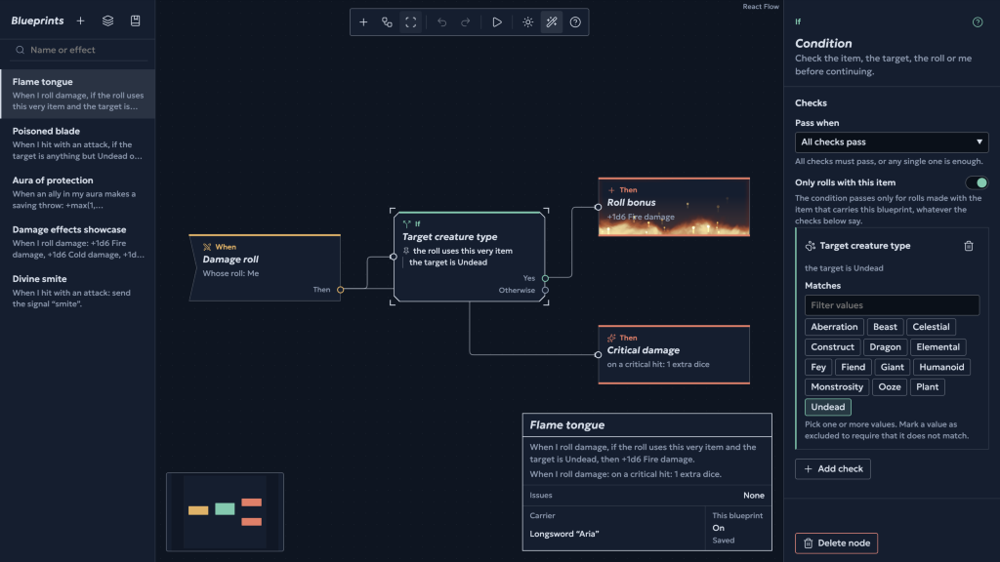
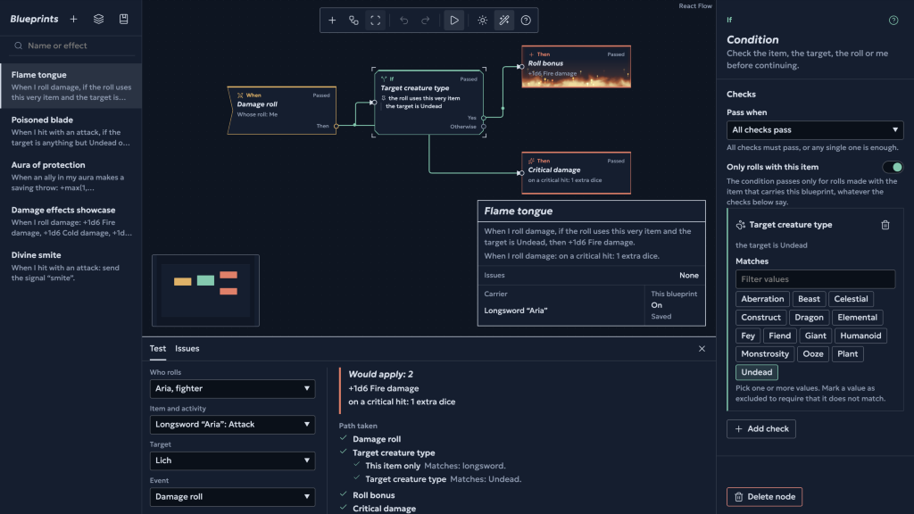
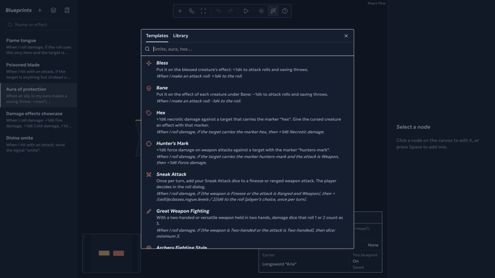

<div align="center">

[English](README.md) · **Русский**

# Build-n-Action

**Визуальная автоматизация правил `Когда → Если → Тогда` (blueprints) для D&D 5e в Foundry VTT**

Собирайте графы из узлов, которые меняют броски до их совершения (бонусы, преимущество/помеха, расширенный крит, повышенная СЛ спасбросков) и реагируют на исход (опрокидывание при попадании, лечение при падении на 0 ХП, требование спасброска, счётчики или бонус к следующему броску).

[](https://github.com/TacticalOtaku/Build-n-Action/releases/latest)
[](https://github.com/TacticalOtaku/Build-n-Action/actions/workflows/ci.yml)
[](https://foundryvtt.com/)
[](https://github.com/foundryvtt/dnd5e)
[](src/lang/)
[](LICENSE)

[Установка](#установка) · [Скриншоты](#скриншоты) · [Быстрый старт](#быстрый-старт) · [Как работают blueprints](#как-работают-blueprints) · [Настройки](#настройки) · [API и хуки](#api-и-хуки) · [Разработка](#разработка)

</div>

---

## Установка

Вставьте **URL манифеста** в окно установки модулей Foundry VTT (**Дополнительные модули → Установить модуль → Manifest URL**):

```text
https://github.com/TacticalOtaku/Build-n-Action/releases/latest/download/module.json
```

**Требования:** Foundry VTT **14.367+** (до `14`), D&D 5e **`5.3.3+`**. Опциональные интеграции: **Midi QOL** (`14.0.12+`) и **DAE** (`14.0.14+`).  
**Ручная установка:** скачайте `build-n-action-v<версия>.zip` со страницы [GitHub Releases](https://github.com/TacticalOtaku/Build-n-Action/releases/latest) и распакуйте в `Data/modules/build-n-action`.

> [!NOTE]
> Всё работает на чистых бросках `dnd5e`. При наличии **Midi QOL** реакции следуют его рабочим процессам; при наличии **DAE** blueprints на активных эффектах учитывают его условия отключения и особые длительности.

---

## Скриншоты





---

## Быстрый старт

1. **Откройте редактор:** откройте лист актёра, предмета, эффекта или региона и выберите **Build-n-Action** в меню заголовка (его иконка светится, пока на документе работает хотя бы один blueprint). Включение параметра _Кнопка Build-n-Action в заголовке окна_ добавляет отдельную кнопку прямо в шапку.
2. **Создайте blueprint:** выберите **Из шаблона** для одного из 14 пресетов D&D 5e или **Новый blueprint** для пустого графа.
3. **Соберите цепочку:** нажмите **Space** на холсте, чтобы добавить узел, и протяните провод от пина — событие (**Когда**) ведёт через необязательные проверки (**Если**) к результатам (**Тогда**), а блок заголовка пересказывает всю цепочку как обычное предложение.
4. **Проверьте в действии:** нажмите **▶ Тест**, чтобы прогнать blueprint на актёре, предмете и цели без фактического броска. Вкладка теста покажет, какой шаг прошёл или остановился и почему.

---

## Как работают blueprints

### Где хранятся blueprints

| Носитель                 | Для кого срабатывает                                                                                              |
| ------------------------ | ----------------------------------------------------------------------------------------------------------------- |
| **Актёр**                | Для бросков этого актёра                                                                                          |
| **Предмет**              | Для бросков владельца, пока предмет надет; отметьте _Только броски этим предметом_ в условии для точной привязки |
| **Активный эффект**      | Для бросков актёра, пока эффект активен                                                                           |
| **Регион**               | Для существ внутри региона                                                                                        |
| **Регион (вход/выход)**  | Для существа, вошедшего в регион или покинувшего его                                                              |

Область действия события (_охват_) также позволяет blueprint срабатывать на других:

- **Аура:** существа в заданном радиусе (при желании с преградой стенами);
- **Шаблон:** существа внутри ваших измеренных шаблонов на сцене.

### Эффекты и DAE

Blueprint на активном эффекте работает ровно до тех пор, пока эффект активен. Всё, что переключает эффект, переключает и blueprint:

- _условие отключения_ DAE (например, `@attributes.hp.value <= 0`);
- особые длительности вроде _0 ХП_;
- экипировка предмета, несущего этот эффект.

В редакторе блок заголовка показывает состояние эффекта и его правила DAE. Команда **Ещё → Перенести на новый эффект** переносит blueprint с актёра или предмета на новый активный эффект.

Условия поддерживают проверки **Мои эффекты** и **Эффекты цели** наряду со стандартными состояниями, позволяя работать с пользовательскими активными эффектами: можно искать по полному названию (без учёта регистра) или выбрать источник эффекта (перетащить Active Effect или указать его UUID) и задать режим **Присутствует** или **Отсутствует**. По умолчанию учитываются только активные эффекты; флажок **Учитывать неактивные эффекты** также включает отключённые и подавленные применимые эффекты (включая переносимые эффекты предметов). Для проверок цели требуется цель; сопоставление по источнику требует сохранённой ссылки на источник (сохраняется действием **Наложить эффект**), а для старых или сторонних копий следует использовать сопоставление по имени.

### Бой, ходы, регионы и отдых

Blueprints могут запускаться и без бросков: в **начале боя**, в **начале или конце хода** в бою, когда токен **входит в регион или выходит из него**, либо после **короткого или продолжительного отдыха**. Они выполняются на стороне ГМ по одному разу и используют результаты, не меняющие бросок: эффекты, ресурсы, напоминания (с гибким выбором получателей: окно броска, владелец, только ГМ, владелец цели (и ГМ) или общий чат), бонус к следующему броску или сигнал. События регионов работают на blueprints, сохранённых на самом регионе; модуль регистрирует поведение региона `blueprints` автоматически.

### «Затем»

У каждого результата в настройках есть переключатель **«Затем»**. Его включение добавляет выходной пин, позволяющий привязать последующие проверки и действия, которые выполнятся только если результат действительно применился:

- обязательный результат — когда бросок состоялся;
- выбор игрока — когда игрок применил его (и оплатил цену), а бросок состоялся;
- ограниченный результат — только пока лимит срабатываний ещё не исчерпан;
- никогда — если результат был отменён через `build-n-action.preApplyResult`.

После **«Затем»** подключаются результаты, не меняющие текущий бросок: наложение или снятие эффекта, трата/восстановление ресурса, бонус к следующему броску, сигнал или напоминание. Они получают тот же бросок, предмет и цель, что и предыдущий результат; опциональные результаты применяются сразу, а напоминания приходят шёпотом владельцам и мастеру.

### Требуемые спасброски

Узел **«Потребовать спасбросок»** заставляет цель, вас или существ в вашей ауре совершить спасбросок против заданной СЛ (фиксированное число, формула или ваша СЛ заклинаний). Его выходы **Успешен** и **Провален** продолжают цепочку после результата спасброска, делая целью существо, проходившее проверку.

Игрок-владелец кидает спасбросок в собственном диалоге, чтобы учлись все его бонусы. Если он не нажмёт **Бросить** в течение 30 секунд (или ни один владелец не в сети), бросок сделает ГМ; если игрок открыл окно, даётся ещё 30 секунд. Для работы требуемых спасбросков в сети должен быть подключён ГМ. Проверки характеристик и события без броска не имеют цели — для них требуйте спасбросок от себя или от ауры.

### Счётчики

Счётчики — это именованные числа на актёре (например, заряды ярости, стаки проклятия, серии попаданий):

- **Изменить счётчик** добавляет, вычитает, задаёт или сбрасывает счётчик; проверки **Счётчик** сравнивают его с числом; формулы читают значения через `@counters.имя` (и `@target.counters.имя`).
- Счётчики могут быть **общими на актёре** или **локальными для одного blueprint**. Минимум, максимум, начальное значение и расписание сброса (вручную, короткий/долгий отдых, долгий отдых или начало хода) настраиваются через **Настроить** в блоке заголовка.
- Ненастроенные счётчики по умолчанию равны `0` (линтер подсвечивает их). Имена нечувствительны к регистру, а пробелы преобразуются в `_`.
- Вкладка **Тест** позволяет переопределять значения счётчиков для тестовых прогонов.

### Библиотека мира

Библиотека мира хранит переиспользуемые blueprints между документами:

- **Ещё → Сохранить в библиотеку** сохраняет копию;
- выбор из **Библиотеки** применяет копию к открытому документу.

Мастера могут импортировать и экспортировать JSON (отдельные blueprints или всю библиотеку целиком), а также перетаскивать blueprints между списками в редакторе.

### Обновление с `1.x`

При обновлении ничего не ломается: бонусы v1 продолжают работать как blueprints, а старые UUID и макросы `buildNAction.hotbarToggle(uuid)` сохраняют работоспособность.

Когда будете готовы, откройте _Настройки модулей → Build-n-Action → Миграция мира_:

1. **Проверить (Scan):** пробный прогон со списком конвертируемых бонусов без изменения мира (опционально включает компендиумы актёров и предметов).
2. **Мигрировать:** переносит бонусы в blueprints, сохраняя исходники как резервные копии.
3. **Удалить резервные копии** после проверки результата.

Повторный запуск миграции никогда не дублирует конвертацию. Обогатитель `@BNA[…]` и вкладка на листе персонажа были удалены в версии 2.0 (см. [CHANGELOG.md](CHANGELOG.md)).

---

## Настройки

| Настройка                                 | Назначение                                                                              |
| ----------------------------------------- | --------------------------------------------------------------------------------------- |
| **Игроки могут править blueprints**       | Игроки могут открывать редактор blueprints на документах, которыми владеют              |
| **Кнопка Build-n-Action в заголовке окна**| Добавляет кнопку в заголовок окна рядом с пунктом меню шапки                            |
| **Отключить проверки-скрипты**            | Проверки-скрипты проходят автоматически без исполнения кода                             |
| **Разрешить убирать провалы**             | Blueprints могут опускать порог критического провала ниже 1                             |
| **Считать ауры от края токена**           | На сценах без сетки добавлять половину размера токена-источника к радиусу ауры          |
| **Показывать радиусы аур**                | Отрисовывать на холсте каждую ауру, которую проверяет бросок                            |
| **Миграция мира**                         | Открывает мастер миграции (только для ГМ)                                               |

---

## API и хуки

### Публичный API

```js
const api = game.modules.get("build-n-action").api; // также globalThis.BuildNAction и buildNAction

api.blueprints.get(document); // сохранённые blueprints, включая бонусы v1
api.blueprints.create(document, data); // новый blueprint, возвращает его
api.blueprints.save(document, blueprint);
api.blueprints.delete(document, id);
api.blueprints.uuid(document, id); // "<document uuid>.Blueprint.<id>"
api.blueprints.toggle(uuid);
api.blueprints.duplicate(uuid);
api.blueprints.fromUuid(uuid); // UUID blueprint или старый "…ContextualBonus.<id>" из v1
api.blueprints.compile(blueprint);
api.blueprints.simulate(blueprint, context); // пробный прогон как во вкладке Тест
api.openEditor(document, { blueprintId });
api.library.list();
api.library.add(blueprint);
api.library.apply(id, document);
api.library.export(ids);
api.library.import(json);
api.library.remove(id);
api.migration.scan(options);
api.migration.run(options);
api.migration.deleteBackups(options);
api.migration.open();
api.getIntegrationStatus(); // Midi QOL и DAE: активен, версия, совместим
api.hotbarToggle(uuid); // макросы v1
```

### Хуки

```js
Hooks.on("build-n-action.ready", (api) => {});
Hooks.on("build-n-action.preEvaluate", (event, context) => {}); // вернуть false, чтобы пропустить
Hooks.on("build-n-action.evaluate", (event, context, results) => {});
Hooks.on("build-n-action.preApplyResult", (result, context) => {}); // вернуть false, чтобы отменить один результат
Hooks.on("build-n-action.applyResult", (result, context) => {});
```

---

## Разработка

Требуется **Node.js 24+** (`npm ci`). GitHub Actions ([ci.yml](.github/workflows/ci.yml)) запускает `npm ci`, `npm run check`, `npm run playground:build` и проверяет, что закоммиченный корневой `module.json` соответствует результату сборки при пушах в `main`. Релизы по тегам `v*` публикуют ZIP-архив и `module.json` через [release.yml](.github/workflows/release.yml).

```bash
npm ci
npm run check             # Проверка типов, ESLint, сборка модуля Vite и Vitest
npm run playground        # Отдельная песочница редактора на http://localhost:5188
npm run playground:build  # Сборка песочницы
npm run build             # Сборка dist/module с source maps (npm run watch для пересборки)
npm run deploy            # Копирование dist/module в Foundry Data/modules/build-n-action
npm run release           # Проверка, затем сборка dist/build-n-action-v<версия>.zip и корневого module.json
```

`npm run release` не перезаписывает уже существующий архив, если не задана переменная `BNA_REPLACE_ARCHIVE=1`. Скрипты живой проверки в консоли Foundry лежат в `tests/live/`; настройка клиента _Отладочный журнал_ включает вывод `log.debug` (`src/core/log.ts`).

| Документ                                           | Назначение                                       |
| -------------------------------------------------- | ------------------------------------------------ |
| [docs/architecture.md](docs/architecture.md)       | Архитектура кода и слои runtime                  |
| [CHANGELOG.md](CHANGELOG.md)                       | История изменений по версиям                     |
| [CONTRIBUTING.md](CONTRIBUTING.md)                 | Правила отправки багрепортов                     |
| [THIRD-PARTY-NOTICES.txt](THIRD-PARTY-NOTICES.txt) | Лицензии включённых сторонних зависимостей       |

---

## Использование ИИ (AI Disclosure)

При разработке использовались ИИ-инструменты как вспомогательный ассистент (черновики кода, рефакторинг, тесты, документация и переводы). Вся архитектура, код, логика работы, пользовательские тексты и русская/английская локализации проверены, протестированы и поддерживаются владельцем репозитория **TacticalOtaku**, который является единственным автором модуля.

Все включённые в пакет ресурсы и материалы соответствуют [политике Foundry VTT в отношении ИИ-контента](https://foundryvtt.com/article/ai-policy/) — модуль не содержит заранее сгенерированных ИИ-артов, аудио или лорного контента.

---

## Обратная связь и лицензия

Pull Requests в этом репозитории отключены; сообщения об ошибках и предложения принимаются через [GitHub Issues](https://github.com/TacticalOtaku/Build-n-Action/issues) (см. [CONTRIBUTING.md](CONTRIBUTING.md)).

Проект распространяется по лицензии **GNU General Public License v3.0** ([LICENSE](LICENSE)). Уведомления сторонних зависимостей приведены в [THIRD-PARTY-NOTICES.txt](THIRD-PARTY-NOTICES.txt).
